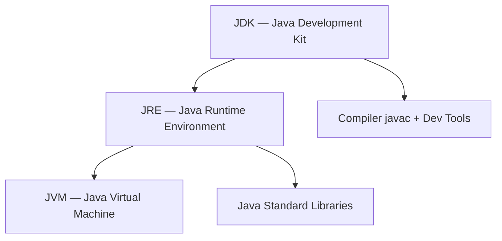

# Phase 00 — Getting Started

Welcome to the beginning of the Java Learning Notebook. This phase gives you the foundation everything else rests on: understanding what Java is, setting up your environment, and running your first program.

---

## Table of Contents
1. [What is Programming?](#what-is-programming)
2. [What is Java?](#what-is-java)
3. [Why Learn Java?](#why-learn-java)
4. [History of Java](#history-of-java)
5. [Java Features](#java-features)
6. [Java Editions](#java-editions)
7. [JDK vs JRE vs JVM](#jdk-vs-jre-vs-jvm)
8. [Installing JDK 21](#installing-jdk-21-on-windows)
9. [Setting Up IntelliJ IDEA](#setting-up-intellij-idea)
10. [Your First Java Program](#your-first-java-program)
11. [Compiling and Running from the Terminal](#compiling-and-running-from-the-terminal)
12. [Java Naming Conventions](#java-naming-conventions)
13. [Exercises](#exercises)

---

## What is Programming?

Programming is the process of giving a computer a precise set of instructions to follow. Computers cannot think — they can only do exactly what they are told, in the exact order they are told to do it. Programming is how you give them those instructions.

**Analogy — a cooking recipe:**  
A recipe is a sequence of steps: gather ingredients, mix them in the right order, apply heat for a defined time. If you follow the recipe perfectly, you get the expected result. If you skip a step or use the wrong ingredient, the dish fails. Writing a program is the same: you define every step, in the right order, with the right data. The computer is the cook that follows your recipe without question.

Programming languages (like Java) exist because computers understand only binary (0s and 1s). A programming language lets you write instructions in a human-readable form, and a tool called a **compiler** translates those instructions into something the computer can execute.

---

## What is Java?

Java is a general-purpose, object-oriented programming language created by James Gosling at Sun Microsystems and released publicly in 1995. You write Java code in plain text files (`.java`), and the Java compiler (`javac`) converts them into **bytecode** (`.class` files).

What makes Java special is that the bytecode does not run directly on your CPU. Instead, it runs on the **Java Virtual Machine (JVM)** — a program that sits between your code and the hardware. Every major operating system (Windows, macOS, Linux) has its own JVM, and they all understand the same bytecode.

This is the basis of Java's famous slogan: **"Write Once, Run Anywhere."** You write and compile your code once; the resulting `.class` file runs on any device that has a JVM installed.

---

## Why Learn Java?

- **Enterprise adoption.** Java powers the backend of banks, insurance companies, logistics platforms, and government systems worldwide. Knowing Java opens doors to large-scale corporate projects.
- **Android development.** Android apps were originally written in Java (and still can be), making Java relevant to billions of mobile devices.
- **Backend APIs.** With Spring Boot, Java is one of the fastest ways to build production-grade REST APIs.
- **Strong job market.** Java consistently ranks in the top three most in-demand languages globally. It is one of the primary languages used at Amalitech.
- **Strict typing catches bugs early.** Java is statically typed — the compiler knows the type of every variable at compile time, so an entire category of bugs is caught before the program even runs.
- **Large community and ecosystem.** Decades of libraries, frameworks, tutorials, and StackOverflow answers mean you are rarely stuck without help.
- **Teaches core programming fundamentals.** Java's strictness about types, classes, and structure makes it an excellent language for learning how programs work.

---

## History of Java

| Year | Event |
|------|-------|
| 1991 | James Gosling begins the "Oak" project at Sun Microsystems, targeting embedded devices |
| 1995 | Oak is renamed Java and publicly released as Java 1.0 |
| 1998 | Java 2 (J2SE 1.2) — a major expansion; introduced the Collections Framework |
| 2004 | Java 5 — generics, enums, annotations, autoboxing, enhanced for loop |
| 2014 | Java 8 LTS — lambda expressions, Stream API, Optional, new Date/Time API |
| 2017 | Java 9 — module system (JPMS), JShell REPL |
| 2018 | Java 10 & 11 — `var` keyword; Java moves to a 6-month release cycle; Java 11 becomes an LTS release |
| 2021 | Java 17 LTS — sealed classes, pattern matching for `instanceof`, records (finalised) |
| 2023 | Java 21 LTS — virtual threads (Project Loom), sequenced collections, pattern matching for `switch` |

> **LTS** = Long-Term Support. LTS releases receive security and bug-fix updates for several years. For production work, always use an LTS version. This notebook targets **Java 21**.

---

## Java Features

- **Platform independent.** Bytecode runs on any OS with a JVM.
- **Object-oriented.** Code is organised into classes and objects.
- **Strongly typed.** Every variable has a declared type; the compiler enforces it.
- **Compiled + interpreted.** Source is compiled to bytecode; the JVM interprets (or JIT-compiles) bytecode at runtime.
- **Automatic memory management.** The garbage collector frees memory you no longer use — no `malloc`/`free` as in C.
- **Rich standard library.** The Java SE class library covers collections, I/O, networking, concurrency, math, security, and more.
- **Multi-threaded.** Built-in support for creating and managing multiple threads of execution.
- **Open source.** OpenJDK is the free, open-source reference implementation of Java.

---

## Java Editions

| Edition | Full Name | Use Case |
|---------|-----------|----------|
| **Java SE** | Standard Edition | Desktop applications, command-line tools, general server-side programs |
| **Jakarta EE** (formerly Java EE) | Enterprise Edition | Large enterprise web apps, application servers (Tomcat, WildFly) |
| **Java ME** | Micro Edition | Embedded and resource-constrained devices |

> This notebook focuses entirely on **Java SE 21**.

---

## JDK vs JRE vs JVM

These three acronyms confuse most beginners. Here is the precise meaning of each.

**JVM — Java Virtual Machine**  
The engine that executes bytecode. It is not a physical machine; it is a program. When you run `java HelloWorld`, the JVM loads the `.class` file, verifies it, and executes its instructions. The JVM also manages memory, the garbage collector, and security. Because each OS has its own JVM, the same `.class` file runs everywhere.

**JRE — Java Runtime Environment**  
The JVM plus the Java standard libraries (the thousands of classes in `java.lang`, `java.util`, `java.io`, etc.). If you only need to *run* a Java program and not write one, the JRE is sufficient. (Note: standalone JRE installers were discontinued from Java 11; modern JDK distributions include everything.)

**JDK — Java Development Kit**  
The JRE plus the development tools: the compiler (`javac`), the archiver (`jar`), the documentation generator (`javadoc`), the debugger (`jdb`), and more. If you are *writing* Java code, you need the JDK.



**Quick rule:** To write Java → install the JDK. To run Java → the JRE (or JDK) is enough.

---

## Installing JDK 21 on Windows

1. Open your browser and go to **https://adoptium.net**
2. Click **Latest LTS release** — make sure it shows **Temurin 21** (JDK, Windows, x64).
3. Download the `.msi` installer.
4. Run the installer. Accept the licence agreement and keep all default settings. The installer sets `JAVA_HOME` and updates your `PATH` automatically.
5. Open a new **Command Prompt** (not an existing one) and verify the installation:
   ```
   java --version
   javac --version
   ```
   You should see output like `openjdk 21.x.x` and `javac 21.x.x`.
6. **If the commands are not recognised**, you need to set `JAVA_HOME` manually:
   - Open **System Properties** → **Advanced** → **Environment Variables**
   - Under *System variables*, click **New**: Variable name = `JAVA_HOME`, value = `C:\Program Files\Eclipse Adoptium\jdk-21.x.x.x-hotspot` (adjust to your actual install path)
   - Find the `Path` variable, click **Edit**, add `%JAVA_HOME%\bin`
   - Click OK everywhere, then reopen Command Prompt and verify again.

---

## Setting Up IntelliJ IDEA

IntelliJ IDEA Community Edition is free and is the standard IDE for Java development at Amalitech.

1. Go to **https://www.jetbrains.com/idea/** and download **Community Edition**.
2. Run the installer. Enable the option to associate `.java` files with IntelliJ if prompted.
3. Launch IntelliJ IDEA and choose **New Project**.
4. Select **Java** on the left. Under **JDK**, click the dropdown — if JDK 21 is not listed, click **Add JDK** and point it to your JDK installation folder.
5. Click **Next**, then **Finish**. IntelliJ creates a project with a `src` folder.
6. Right-click `src` → **New** → **Java Class** → name it `HelloWorld`.
7. Type your program (see below) and press the green **Run** button (▶) in the gutter next to `main`, or press **Shift+F10**.

**Useful IntelliJ shortcuts:**
| Shortcut | Action |
|----------|--------|
| `Shift+F10` | Run current configuration |
| `Shift+F9` | Debug |
| `Alt+Enter` | Quick fix / import suggestion |
| `Ctrl+Space` | Code completion |
| `Ctrl+/` | Toggle line comment |
| `Shift+F6` | Rename (refactor) |
| `Ctrl+Alt+L` | Format code |

---

## Your First Java Program

```java
public class HelloWorld {
    public static void main(String[] args) {
        System.out.println("Hello, World!");
    }
}
```

**Output:**
```
Hello, World!
```

**Line-by-line breakdown:**

| Code | Meaning |
|------|---------|
| `public` | Access modifier — this class is visible from anywhere |
| `class` | Keyword that declares a class |
| `HelloWorld` | The class name — must exactly match the filename `HelloWorld.java` |
| `{` | Opens the class body |
| `public static void main(String[] args)` | The entry point — Java starts execution here |
| `public` | The method is accessible from anywhere (required for `main`) |
| `static` | The method belongs to the class, not an instance — Java can call it without creating a `HelloWorld` object |
| `void` | The method returns nothing |
| `main` | The special name the JVM looks for as the starting point |
| `String[] args` | An array of command-line arguments (may be empty; still required) |
| `System.out.println(...)` | `System` is a class, `out` is a static `PrintStream` field, `println` is a method that prints text and moves to the next line |
| `"Hello, World!"` | A String literal — the text to print |
| `}` (inner) | Closes the `main` method |
| `}` (outer) | Closes the class |

---

## Compiling and Running from the Terminal

You do not always need an IDE. Understanding how to compile and run from the terminal makes you a more confident developer.

```bash
# Step 1: Compile the source file
javac HelloWorld.java

# This produces HelloWorld.class (the bytecode file)

# Step 2: Run the program
java HelloWorld

# Output:
# Hello, World!
```

> **Important:** When running with `java`, do NOT include `.class` — just the class name: `java HelloWorld`, not `java HelloWorld.class`.

**What if you get an error?**
- `error: class HelloWorld is public, should be declared in a file named HelloWorld.java` — the filename does not match the class name. They must be identical, including capitalisation.
- `cannot find symbol` — a variable or method name is misspelled, or an import is missing.
- `Exception in thread "main"` — a runtime error. Read the message: it tells you the exception type and the line number.

---

## Java Naming Conventions

Following consistent naming conventions makes code readable. Java has well-established rules, reinforced by the Amalitech Coding Standards.

| Element | Convention | Examples |
|---------|-----------|---------|
| **Classes** | UpperCamelCase (PascalCase) | `BankAccount`, `StudentGradeSystem`, `HttpRequest` |
| **Interfaces** | UpperCamelCase | `Printable`, `Comparable`, `UserRepository` |
| **Methods** | lowerCamelCase — verb or verb phrase | `calculateTotal()`, `getName()`, `isValid()` |
| **Variables** | lowerCamelCase — noun or noun phrase | `firstName`, `accountBalance`, `isActive` |
| **Constants** | UPPER_SNAKE_CASE | `MAX_SIZE`, `DEFAULT_TIMEOUT`, `PI` |
| **Packages** | all lowercase, dot-separated | `com.amalitech.inventory`, `org.example.utils` |
| **Enums** | UpperCamelCase; constants in UPPER_SNAKE_CASE | `enum Direction { NORTH, SOUTH, EAST, WEST }` |

**Rules enforced by the Amalitech Coding Standards (§3.5):**
- Use intention-revealing names — the name should tell you *what* the variable is for, not *what type* it is.
- Do NOT use Hungarian notation: `strName`, `iCount`, `bFlag` are banned.
- Do NOT start variable names with `_` or `$`.

```java
// ✅ Good — Amalitech §3.1
int studentCount = 30;
String firstDayOfWeek = "Monday";
boolean isEnrolled = true;
final int MAX_RETRIES = 3;

// ❌ Bad — Amalitech §3.1
int x = 30;
String d = "Monday";
boolean flag = true;
int iMaxRetries = 3;   // Hungarian notation
```

> 📖 **Amalitech Standard:** §3.5 — Variable Naming; §11.1 — One declaration per line.

---

## Exercises

Complete these in the `00-getting-started/exercises/` folder. Create one `.java` file per exercise.

**Exercise 1 — Hello, You!**  
Modify the `HelloWorld` program to print your own name and role. Output:
```
Hello, my name is John Okyere.
I am a Systems Engineer at Amalitech.
```

**Exercise 2 — Multi-Line Greeting**  
Write a program that prints a formatted greeting card with five lines: a top border, your name, today's date (hardcoded as a String), a motivational message, and a bottom border. Use only `System.out.println()`.

**Exercise 3 — Explore the main Method**  
Create a class `MainExplorer`. Add a second method `showInfo()` that prints "Java version: 21". Call `showInfo()` from `main`. Run the program and confirm both messages appear.

**Exercise 4 — Terminal Compile and Run**  
Write a class `TerminalHello` that prints "Compiled and run from the terminal!". Compile it with `javac` and run it with `java` from your terminal (not from IntelliJ). Take note of the commands you used.

**Exercise 5 — Naming Convention Practice**  
Look at the following variable names and rewrite each one following Java/Amalitech naming conventions:  
- `strFirstName` → ?  
- `int_account_balance` → ?  
- `EMPLOYEENAME` → ?  
- `d` (stores day of week) → ?  
- `bIsLoggedIn` → ?
