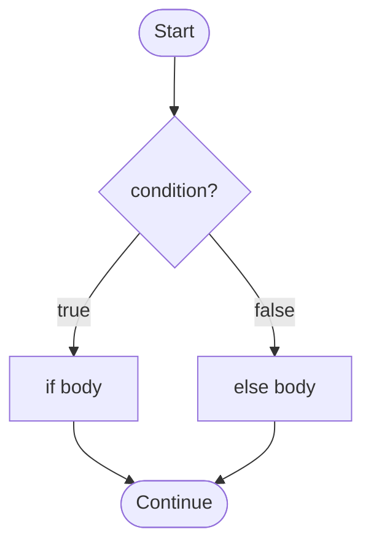

# if Statements

## What is an if Statement?
An if statement lets your program make a decision: "IF this condition is true, THEN do this."

**Real-world analogy:** A security guard at a building checks an ID. IF the person is on the guest list, THEN let them in. ELSE turn them away.

## Syntax Forms

```java
// 1. Simple if
if (condition) {
    // runs only if condition is true
}

// 2. if-else
if (condition) {
    // runs if true
} else {
    // runs if false
}

// 3. else-if chain
if (score >= 90) {
    grade = "A";
} else if (score >= 80) {
    grade = "B";
} else if (score >= 70) {
    grade = "C";
} else {
    grade = "F";
}
```

## Braces Rule (Amalitech §11.1)
Always use braces, even for single-statement bodies:
```java
// BAD (Amalitech §11.1):
if (score > 50) System.out.println("Pass");

// GOOD (Amalitech §11.1):
if (score > 50) {
    System.out.println("Pass");
}
```
> 📖 **Official Amalitech Standard:** Braces are always used with `if`, even when the body is a single statement. See §11.1 of the Amalitech Coding Standards.

## Mermaid Flowchart


## Basic Example
```java
public class TemperatureCheck {
    public static void main(String[] args) {
        int temperature = 35;

        if (temperature > 30) {
            System.out.println("It's hot outside!");
        } else if (temperature > 20) {
            System.out.println("Nice weather.");
        } else if (temperature > 10) {
            System.out.println("A bit cool.");
        } else {
            System.out.println("Cold!");
        }
    }
}
```
Output: `It's hot outside!`

## Nested Conditions
```java
int age = 20;
boolean hasTicket = true;

if (age >= 18) {
    if (hasTicket) {
        System.out.println("Welcome to the event!");
    } else {
        System.out.println("You need a ticket.");
    }
} else {
    System.out.println("You must be 18 or older.");
}
```

## Combining Conditions
```java
// Use && (AND) and || (OR) to combine conditions
if (age >= 18 && hasTicket) {
    System.out.println("Welcome!");
}

if (isVIP || hasPremiumTicket) {
    System.out.println("VIP access granted.");
}
```

## Common Mistakes

1. **Using `=` (assignment) instead of `==` (comparison):** `if (x = 5)` is a compile error in Java (not like C).
2. **Forgetting braces** and adding a second statement that looks part of the if but isn't.
3. **Comparing strings with `==`** instead of `.equals()`. `==` checks reference equality, not content.
4. **Unreachable else-if:** putting a broad condition before a narrow one (e.g. `>= 60` before `>= 90`).

## Best Practices
- Keep conditions readable: extract complex conditions to a boolean variable with a good name.
- Avoid deeply nested conditions — extract into methods.
- Prefer positive conditions: `if (isValid)` over `if (!isInvalid)`.

## Exercises

**Exercise 1:** Write a program that asks for a number and prints "positive", "negative", or "zero".

**Exercise 2:** Age category classifier — given an age, print: child (< 13), teen (13–17), adult (18–64), senior (65+).

**Exercise 3:** Login checker — check that username equals `"admin"` AND password equals `"1234"`. Print "Access granted" or "Access denied".

**Exercise 4:** Traffic light — given a colour (`"red"`, `"amber"`, or `"green"`), print the correct driving instruction.

**Exercise 5:** Leap year checker. A year is a leap year if it is divisible by 4, EXCEPT for century years, which must be divisible by 400. (e.g. 2000 is a leap year, 1900 is not.)
