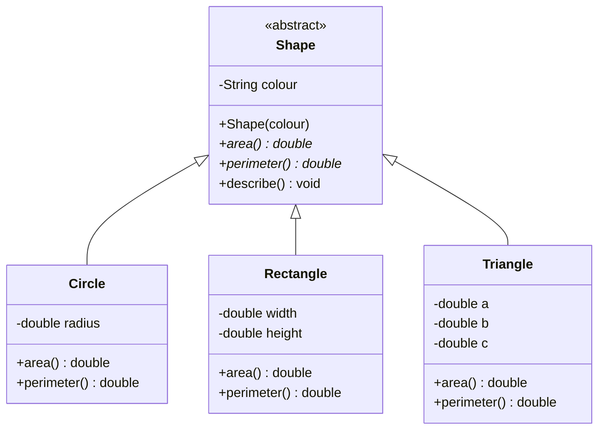

# Abstraction

## What is Abstraction?
Abstraction means hiding implementation details and showing only what is necessary. Users of your class know **what** it does, not **how** it does it.

**Analogy:** You drive a car without knowing how the engine works. The steering wheel abstracts away the complex mechanics of the steering column, rack-and-pinion gears, and power steering pump. You turn the wheel; the car turns. The *how* is hidden.

---

## Two Tools for Abstraction in Java

1. **Abstract classes** — partially implemented classes that force subclasses to complete the implementation.
2. **Interfaces** — pure contracts (no implementation) that define what a type can do. (Covered in depth in the next topic.)

---

## Abstract Classes

An abstract class:
- Cannot be instantiated with `new` — it is a template, not a concrete thing
- Can have **abstract methods**: declared but not implemented — subclasses **must** implement them
- Can have **concrete methods**: fully implemented — subclasses inherit these for free

```java
// Abstract class — cannot be instantiated
public abstract class Shape {
    private String colour;

    public Shape(String colour) {
        this.colour = colour;
    }

    // Abstract methods — no implementation; subclass MUST provide one
    public abstract double area();
    public abstract double perimeter();

    // Concrete method — has implementation; inherited by all subclasses
    public void describe() {
        System.out.printf("A %s shape: area = %.2f, perimeter = %.2f%n",
                          colour, area(), perimeter());
    }

    public String getColour() {
        return colour;
    }
}
```

```java
public class Circle extends Shape {
    private double radius;

    public Circle(String colour, double radius) {
        super(colour);
        this.radius = radius;
    }

    @Override
    public double area() {
        return Math.PI * radius * radius;
    }

    @Override
    public double perimeter() {
        return 2 * Math.PI * radius;
    }
}

public class Rectangle extends Shape {
    private double width;
    private double height;

    public Rectangle(String colour, double width, double height) {
        super(colour);
        this.width = width;
        this.height = height;
    }

    @Override
    public double area() {
        return width * height;
    }

    @Override
    public double perimeter() {
        return 2 * (width + height);
    }
}
```

```java
// new Shape("red"); — COMPILE ERROR: Shape is abstract

Shape circle = new Circle("red", 5.0);
Shape rect   = new Rectangle("blue", 4.0, 6.0);

circle.describe();  // A red shape: area = 78.54, perimeter = 31.42
rect.describe();    // A blue shape: area = 24.00, perimeter = 20.00
```

---

## Abstract Class Rules

| Rule | Detail |
|------|--------|
| Cannot instantiate | `new Shape()` is a compile error |
| Subclass must implement all abstract methods | Or the subclass itself must be declared abstract |
| Can mix abstract and concrete methods | Concrete methods are inherited as-is |
| Can have constructors | Called via `super()` from the subclass |
| Can have fields | Instance fields are inherited |

---

## Abstract Class vs Interface — When to Use Which

This is one of the most common design questions in Java OOP.

| | Abstract Class | Interface |
|---|---|---|
| Constructor | ✅ Yes | ❌ No |
| Instance fields | ✅ Yes | ❌ No (only constants) |
| Concrete methods | ✅ Yes | ✅ Yes (default methods, Java 8+) |
| Multiple inheritance | ❌ No (single parent) | ✅ Yes (many interfaces) |
| Use when | You want to share code + enforce a structure among related classes | You want to define a capability or contract that unrelated classes can fulfil |

**Practical rule:**
- Use an **abstract class** when subclasses share significant code and are clearly related types (e.g. `Shape`, `Animal`).
- Use an **interface** when you want to define a capability that any type could have regardless of its class hierarchy (e.g. `Printable`, `Serializable`, `Comparable`).

---

## Mermaid Diagram



---

## Exercises

**Exercise 1:** Create an abstract class `Vehicle` with abstract methods `fuelType()` and `maxSpeed()`, and a concrete method `describe()` that prints both. Create subclasses `ElectricCar`, `PetrolCar`, and `Bicycle`. Test polymorphically.

**Exercise 2:** Create an abstract class `Employee` with an abstract method `calculatePay()`. Create concrete subclasses `FullTimeEmployee` (monthly salary) and `PartTimeEmployee` (hourly rate × hours). Use an array of `Employee` to calculate total payroll.

**Exercise 3:** Given this abstract class, what compile errors occur and why?
```java
public abstract class Animal {
    public abstract void makeSound();
    public void sleep() { System.out.println("Zzz..."); }
}

public class Fish extends Animal {
    // makeSound() not implemented
}

Animal a = new Animal();  // is this allowed?
```

**Exercise 4:** Design an abstract class `DatabaseConnection` with abstract methods `connect()`, `disconnect()`, and `executeQuery(String sql)`, plus a concrete `logQuery(String sql)` method. Write two concrete implementations: `MySQLConnection` and `PostgreSQLConnection` with stubbed implementations.

**Exercise 5:** Rewrite the `Shape` hierarchy above but add a `Triangle` subclass. Use Heron's formula for the triangle's area: given sides a, b, c, `s = (a+b+c)/2`, `area = sqrt(s*(s-a)*(s-b)*(s-c))`. Show that `describe()` works without modification.
