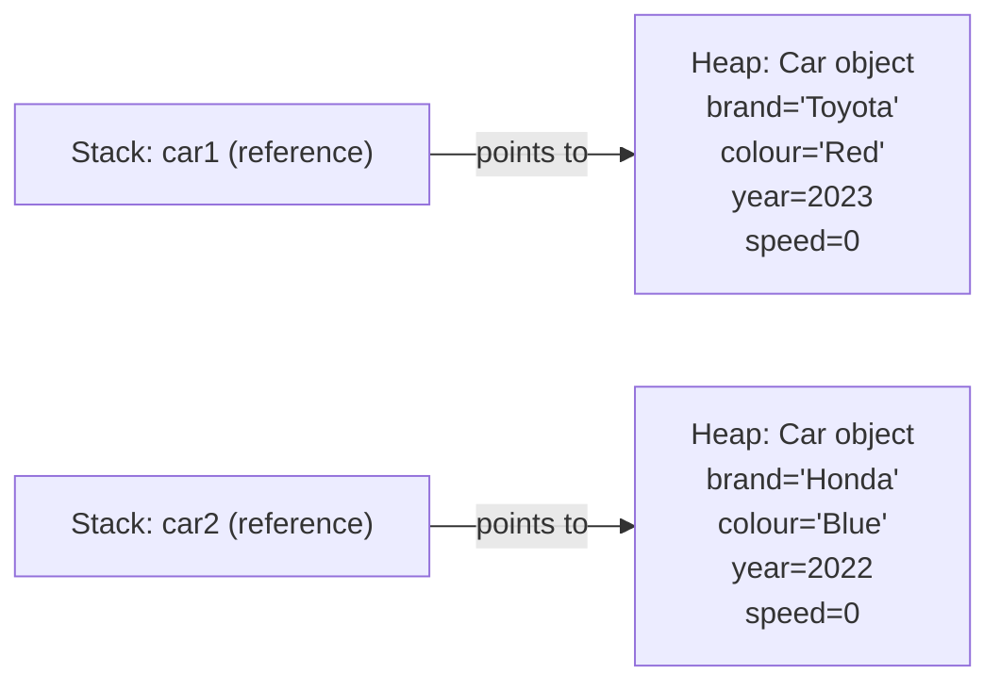

# Classes and Objects

## What is a Class?
A class is a **blueprint** or template. It defines what data (fields) and behaviour (methods) any object of that type will have. The class itself is not a thing — it is a description of a thing.

## What is an Object?
An object is an **instance** of a class — a real, concrete thing created from the blueprint at runtime. You can create many independent objects from one class.

**Analogy:** A class is an architectural plan for a house. An object is an actual house built from that plan. You can build many different houses from the same plan — each has its own address, colour, and occupants, but all follow the same structure.

---

## Defining a Class

```java
// This is the BLUEPRINT (class)
public class Car {

    // Fields (data) — what every Car has
    String brand;
    String colour;
    int year;
    double speed;

    // Methods (behaviour) — what every Car can do
    public void accelerate(double amount) {
        speed += amount;
        System.out.println(brand + " is now going " + speed + " km/h");
    }

    public void brake() {
        speed = 0;
        System.out.println(brand + " has stopped.");
    }

    @Override
    public String toString() {
        return year + " " + brand + " (" + colour + ")";
    }
}
```

---

## Creating Objects (Instances)

```java
public class Main {
    public static void main(String[] args) {

        Car car1 = new Car();      // create first object using 'new'
        car1.brand = "Toyota";
        car1.colour = "Red";
        car1.year = 2023;

        Car car2 = new Car();      // create second object — independent of car1
        car2.brand = "Honda";
        car2.colour = "Blue";
        car2.year = 2022;

        car1.accelerate(60);       // Toyota is now going 60.0 km/h
        car2.accelerate(80);       // Honda is now going 80.0 km/h

        car1.brake();              // Toyota has stopped.
        // car2 is unaffected — different object, different speed field

        System.out.println(car1);  // 2023 Toyota (Red)
        System.out.println(car2);  // 2022 Honda (Blue)
    }
}
```

Each `Car` object has its **own copy** of `brand`, `colour`, `year`, and `speed`. Calling `car1.accelerate()` does not change `car2.speed`.

---

## Memory Model

When you write `Car car1 = new Car()`:
- `new Car()` creates a `Car` object on the **heap** (the main memory area for objects)
- `car1` is a **reference variable** on the **stack** that holds the memory address of that heap object



**What this means in practice:**
- `Car car1 = car2;` does NOT copy the object — both variables now point to the same object on the heap
- Changes through `car1` will be visible through `car2` if they share the same object

```java
Car car1 = new Car();
car1.brand = "Toyota";

Car car2 = car1;        // car2 points to the SAME object as car1
car2.brand = "Nissan";

System.out.println(car1.brand);  // Nissan — because car1 and car2 point to the same object!
```

---

## toString()
Override `toString()` to get a meaningful description when you print an object. Without it, Java prints the class name and memory address: `Car@1b6d3586`.

```java
@Override
public String toString() {
    return year + " " + brand + " (" + colour + ")";
}

System.out.println(car1);  // 2023 Toyota (Red)  — much more useful
```

> 📖 **Amalitech §8:** Expose behaviour, not raw data. `toString()` is a good example of exposing useful information through a method rather than letting callers read raw fields.

---

## Common Mistakes

1. **Forgetting `new`** when creating an object:
   ```java
   Car car;                  // just a reference variable — points to nothing
   car.brand = "Toyota";     // NullPointerException!
   ```
   Fix: `Car car = new Car();`

2. **Directly accessing fields** instead of using methods — breaks encapsulation (covered in the next topic).

3. **Confusing the class with an object:** `Car.accelerate(60)` does not make sense — only `car1.accelerate(60)` does, because `accelerate()` needs to know *which* car's speed to change.

---

## Exercises

**Exercise 1:** Create a `Person` class with fields: `name` (String), `age` (int), `email` (String). Write a `toString()` method. Create three `Person` objects in `main()` and print them.

**Exercise 2:** Create a `Rectangle` class with fields `width` and `height`. Add methods `area()` and `perimeter()`. Create two rectangles and compare their areas.

**Exercise 3:** Create a `Dog` class with fields `name`, `breed`, and `age`. Add methods `bark()` (prints "Woof!"), `fetch(String item)` (prints "name fetches the item"), and `toString()`. Test it with two different dogs.

**Exercise 4:** Demonstrate reference sharing: create a `Point` class with fields `x` and `y`. Create a point, assign it to a second variable, change `x` through the second variable, and show that the first variable sees the change.

**Exercise 5:** Create a `Counter` class with a private `count` field, an `increment()` method, a `reset()` method, and a `getValue()` method. Create two independent `Counter` objects and show they maintain separate counts.
