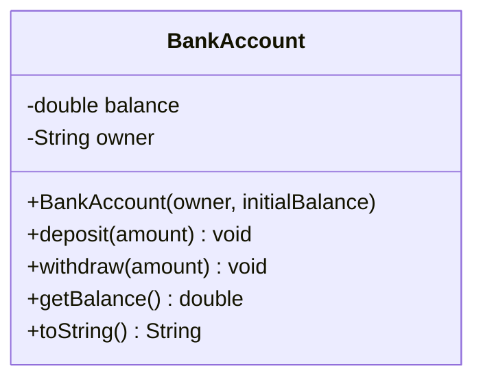

# Encapsulation

## What is Encapsulation?
Encapsulation means two things working together:
1. **Bundling** data (fields) and the methods that work on that data into one class.
2. **Hiding** the internal state and only exposing what is necessary through controlled methods.

**Analogy:** A bank account has a balance. You cannot directly reach into the bank vault and change your balance. You must go through controlled operations — deposit and withdraw. The bank enforces rules: you cannot withdraw more than your balance, you cannot deposit a negative amount. That is encapsulation.

---

## Why It Matters (Amalitech §8)

> 📖 **Official Amalitech Standard:** §8 — "Keep fields private and expose behaviour, not data."

If fields are `public`, any code anywhere in the program can change them in ways you didn't intend. Making fields `private` and providing methods means the class controls its own state and can enforce rules.

---

## Access Modifiers

| Modifier | Same class | Same package | Subclass | Everywhere |
|----------|:---:|:---:|:---:|:---:|
| `private` | ✅ | ❌ | ❌ | ❌ |
| *(package-private, no keyword)* | ✅ | ✅ | ❌ | ❌ |
| `protected` | ✅ | ✅ | ✅ | ❌ |
| `public` | ✅ | ✅ | ✅ | ✅ |

**Rule of thumb:** Start with `private`. Only increase access when there is a good reason.

---

## Class Diagram



The `-` prefix means `private`; `+` means `public`. The class diagram shows what the outside world can see (the public interface) without revealing the implementation details.

---

## Without Encapsulation (BAD)

```java
// Anyone can set balance to any value — no rules enforced
public class BankAccount {
    public double balance;   // BAD: public field
    public String owner;
}

BankAccount account = new BankAccount();
account.balance = -50000;    // Should NOT be allowed!
account.owner = null;        // Should NOT be allowed!
```

There is nothing stopping a caller from putting the object into an invalid state. Any bug anywhere in the program can corrupt this data.

---

## With Encapsulation (GOOD)

```java
public class BankAccount {
    private double balance;    // private — only this class can change it
    private String owner;

    public BankAccount(String owner, double initialBalance) {
        if (owner == null || owner.isBlank()) {
            throw new IllegalArgumentException("Owner name cannot be blank");
        }
        if (initialBalance < 0) {
            throw new IllegalArgumentException("Initial balance cannot be negative");
        }
        this.owner = owner;
        this.balance = initialBalance;
    }

    public void deposit(double amount) {
        if (amount <= 0) {
            throw new IllegalArgumentException("Deposit amount must be positive");
        }
        balance += amount;
    }

    public void withdraw(double amount) {
        if (amount <= 0) {
            throw new IllegalArgumentException("Withdrawal amount must be positive");
        }
        if (amount > balance) {
            throw new IllegalStateException("Insufficient funds. Balance: " + balance);
        }
        balance -= amount;
    }

    public double getBalance() {
        return balance;    // read-only access — nobody can directly set balance
    }

    public String getOwner() {
        return owner;
    }

    @Override
    public String toString() {
        return owner + ": $" + String.format("%.2f", balance);
    }
}
```

```java
BankAccount account = new BankAccount("Alice", 1000.0);
account.deposit(500.0);
account.withdraw(200.0);
System.out.println(account);             // Alice: $1300.00
System.out.println(account.getBalance()); // 1300.0

// account.balance = -50000;  COMPILE ERROR — balance is private
```

---

## Getters and Setters

Getters (accessors) return a field value. Setters (mutators) allow controlled modification.

```java
private String name;

// Getter
public String getName() {
    return name;
}

// Setter with validation
public void setName(String name) {
    if (name == null || name.isBlank()) {
        throw new IllegalArgumentException("Name cannot be blank");
    }
    this.name = name;
}
```

> **Naming convention (Amalitech §3):** Getters are named `getFieldName()`. For booleans, `isFieldName()`. Setters are named `setFieldName(Type value)`.

---

## When NOT to Write Getters/Setters for Everything

A class with only getters, setters, and no behaviour is called an **anemic class**. It provides no encapsulation benefit — it is just a struct with extra ceremony.

Ask: "Does exposing this field via a getter/setter make sense for the design?"
- `getBalance()` on `BankAccount` — yes, callers need to know the balance.
- `setBalance(double)` on `BankAccount` — probably not. Use `deposit()` and `withdraw()` instead, which enforce rules.

For simple data carriers with no logic, consider a Java **record** (Java 16+):
```java
// Immutable data carrier — compact, no boilerplate
public record Point(double x, double y) {}

Point p = new Point(3.0, 4.0);
System.out.println(p.x());   // 3.0
System.out.println(p);       // Point[x=3.0, y=4.0]
```

---

## Exercises

**Exercise 1:** Create a `Person` class with private fields `name`, `age`, and `email`. Add getters for all three. Add a setter for `email` that validates it contains `@`. Test valid and invalid emails.

**Exercise 2:** Create a `Temperature` class with a private `celsius` field. Provide `getCelsius()`, `getFahrenheit()`, and `getKelvin()` getters (all computed from the same field). Add a `setCelsius(double)` setter that rejects values below absolute zero (-273.15°C).

**Exercise 3:** Create a `ShoppingCart` class with a private `List<String>` of items and a private `total` (double). Add `addItem(String name, double price)`, `removeItem(String name, double price)`, `getTotal()`, and `getItemCount()`. Ensure `total` can never go below zero.

**Exercise 4:** Explain (in comments) what goes wrong with this code and fix it:
```java
public class Counter {
    public int count = 0;
}
// In main:
Counter c = new Counter();
c.count = -100;  // allowed! Is this a problem?
```

**Exercise 5:** Create an `ImmutablePoint` class with private `final` fields `x` and `y`. Provide only getters — no setters. Show that once created, an `ImmutablePoint` cannot be modified. Discuss when immutability is a good design choice.
