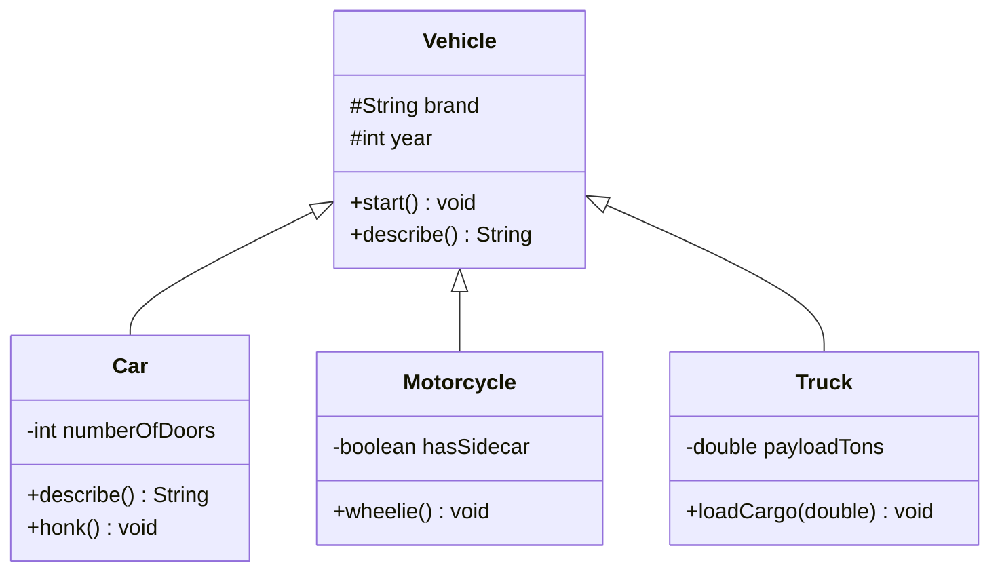

# Inheritance

## What is Inheritance?
Inheritance lets one class (the **child** or **subclass**) acquire the fields and methods of another class (the **parent** or **superclass**). The child automatically has everything the parent has, and can also add its own fields, methods, and override inherited behaviour.

**Analogy:** Every car is a vehicle. A vehicle has wheels, can move, and needs fuel. A car inherits all of that — plus it adds its own specifics: number of doors, trunk space, air conditioning. You didn't have to redefine "can move" for the car. It inherited it.

---

## The extends Keyword

```java
// Parent class — defines shared behaviour
public class Vehicle {
    protected String brand;   // 'protected' so subclasses can access it
    protected int year;

    public Vehicle(String brand, int year) {
        this.brand = brand;
        this.year = year;
    }

    public void start() {
        System.out.println(brand + " starting...");
    }

    public String describe() {
        return year + " " + brand;
    }
}

// Child class — inherits from Vehicle
public class Car extends Vehicle {
    private int numberOfDoors;

    public Car(String brand, int year, int numberOfDoors) {
        super(brand, year);  // MUST call parent constructor first
        this.numberOfDoors = numberOfDoors;
    }

    // Override parent method to add car-specific detail
    @Override
    public String describe() {
        return super.describe() + " (" + numberOfDoors + " doors)";
    }

    // New method specific to Car
    public void honk() {
        System.out.println(brand + " goes beep!");
    }
}
```

```java
Car car = new Car("Toyota", 2023, 4);
car.start();          // inherited from Vehicle — "Toyota starting..."
System.out.println(car.describe());  // "2023 Toyota (4 doors)"
car.honk();           // only on Car — "Toyota goes beep!"
```

---

## The super Keyword

`super` has two uses:

**1. Call the parent constructor** (must be the first statement in the child constructor):
```java
public Car(String brand, int year, int numberOfDoors) {
    super(brand, year);  // calls Vehicle(String, int)
    this.numberOfDoors = numberOfDoors;
}
```
If you don't call `super(...)` explicitly and the parent has no no-arg constructor, the code won't compile.

**2. Call the parent version of an overridden method:**
```java
@Override
public String describe() {
    return super.describe() + " (" + numberOfDoors + " doors)";
    //     ^^^^^^^^^^^^^^^^
    //     calls Vehicle.describe() — avoids duplicating the year + brand logic
}
```

---

## @Override

Always use `@Override` when you intend to override a parent method. If you misspell the method name, the compiler reports an error. Without it, you silently create a new method instead of overriding.

```java
// Without @Override — silent mistake
public String Describe() {  // capital D — a NEW method, not an override!
    return "oops";
}

// With @Override — compiler catches the mistake
@Override
public String Describe() {  // Error: method does not override anything
    return "oops";
}
```

---

## Inheritance Diagram



---

## What is Inherited?

| Item | Inherited? |
|------|-----------|
| `public` fields | ✅ Yes |
| `protected` fields | ✅ Yes |
| `public` methods | ✅ Yes |
| `protected` methods | ✅ Yes |
| `private` fields | ❌ No (but accessible via parent's methods) |
| `private` methods | ❌ No |
| Constructors | ❌ No (must call via `super()`) |

---

## When NOT to Use Inheritance

Inheritance creates strong coupling between parent and child. Only use it when the relationship is a true **is-a**:

| Relationship | Verdict |
|---|---|
| Car IS-A Vehicle | ✅ Use inheritance |
| Dog IS-A Animal | ✅ Use inheritance |
| Manager IS-A Employee | ✅ Probably fine |
| EmailService IS-A Database | ❌ Use composition instead |
| Stack IS-A ArrayList | ❌ This is a famous Java mistake (java.util.Stack) |

> 📖 **Amalitech §2.2:** "Composition over inheritance: design types around what they do, not what they are. Prefer holding a collaborator to extending a class." See the Composition topic for details.

---

## final Classes and Methods

- `final class` — cannot be extended. Use to prevent subclassing (e.g. `String`, `Integer` are final).
- `final` method — cannot be overridden in a subclass. Use to lock critical behaviour.

```java
public final class ImmutableConfig {  // nobody can extend this
    // ...
}

public class PaymentProcessor {
    public final void validateAmount(double amount) {  // subclasses cannot change this
        if (amount <= 0) throw new IllegalArgumentException("Must be positive");
    }
}
```

---

## Exercises

**Exercise 1:** Create a `Shape` parent class with fields `colour` and a method `describe()`. Create two subclasses: `Circle` (adds `radius`) and `Rectangle` (adds `width` and `height`). Both should override `describe()` using `super.describe()` to include the colour.

**Exercise 2:** Create an `Animal` class with a `name` field and a `makeSound()` method that prints "...". Create subclasses `Dog`, `Cat`, and `Bird` that override `makeSound()` with appropriate sounds. Create an array of `Animal` and call `makeSound()` on each.

**Exercise 3:** Create an `Employee` class with `name` and `baseSalary`. Create a `Manager` class that extends `Employee` and adds a `bonus` field. Override `toString()` in both. `Manager.toString()` should use `super.toString()`.

**Exercise 4:** Demonstrate `final`: create a `BankTransaction` class with a `final` method `validate()`. Attempt to override it in a subclass. Describe what the compiler says.

**Exercise 5:** Identify what is wrong with this design and explain how you would fix it:
```java
class Stack extends ArrayList {  // Stack IS-A ArrayList?
    public void push(Object item) { add(item); }
    public Object pop() { return remove(size() - 1); }
}
// Problem: Stack exposes all ArrayList methods (add at index, remove at index, etc.)
// which allow bypassing the Stack's LIFO contract
```
