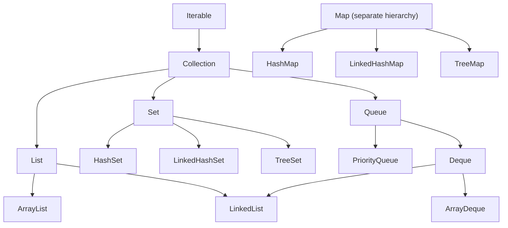

# Phase 05 — Arrays and Collections

A collection is a container for multiple values. Java provides built-in collection types for every situation — from simple fixed-size arrays to flexible maps and sorted sets.

## Collections Hierarchy

> **Note:** `Map` is not part of the `Collection` hierarchy — it is a separate interface that maps keys to values.

## Topics in this Phase

| Topic | Description |
|-------|-------------|
| [Arrays](./arrays/README.md) | Fixed-size, primitive-friendly storage |
| [ArrayList](./arraylist/README.md) | The most-used List — dynamic, ordered |
| [Sets](./sets/README.md) | Unique elements; HashSet, TreeSet |
| [Maps](./maps/README.md) | Key-value pairs; HashMap, TreeMap |
| [Queues and Stacks](./queues-stacks/README.md) | FIFO and LIFO data structures |
| [Generics](./generics/README.md) | Type-safe collections |
| [Exercises](./exercises/README.md) | Practice problems for this phase |

## Prerequisites
Phase 04 — OOP (classes, interfaces, generics require understanding of types)

## Learning Goals
After completing this phase you should be able to:
- Choose the right collection type for each situation
- Understand the performance trade-offs between collection types
- Write type-safe generic code with `<T>` syntax
- Use `Arrays` utility class for sorting, searching, and copying
- Iterate over any collection with for-each
- Use `List.of()`, `Set.of()`, `Map.of()` for immutable collections

## Quick Reference — Which Collection to Use?

| Need | Use |
|------|-----|
| Fixed-size, same type, primitives OK | `array` |
| Ordered, allows duplicates, random access | `ArrayList` |
| Ordered, frequent insert/delete at start | `LinkedList` |
| No duplicates, fastest | `HashSet` |
| No duplicates, insertion order | `LinkedHashSet` |
| No duplicates, sorted | `TreeSet` |
| Key → Value, fastest lookup | `HashMap` |
| Key → Value, insertion order | `LinkedHashMap` |
| Key → Value, sorted by key | `TreeMap` |
| FIFO queue | `ArrayDeque` |
| LIFO stack | `ArrayDeque` |
| Priority-based processing | `PriorityQueue` |
