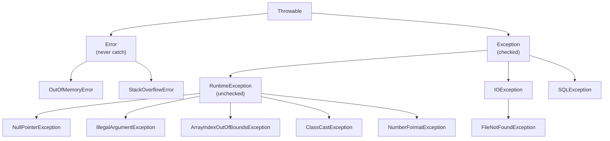

# Phase 06 — Exception Handling

## What is this phase about?

Exceptions are Java's mechanism for dealing with unexpected situations at runtime — a file that does not exist, a network connection that drops, invalid user input, division by zero. This phase teaches you how to detect, report, and recover from these situations in a controlled way.

---

## The Exception Hierarchy

---

## Checked vs Unchecked — At a Glance

| Type | Hierarchy | Must declare/catch? | Example |
|---|---|---|---|
| **Checked** | `Exception` (not `RuntimeException`) | Yes — compiler enforces | `IOException`, `SQLException` |
| **Unchecked** | `RuntimeException` | No — compiler does not require | `NullPointerException`, `IllegalArgumentException` |
| **Error** | `Error` | No — but should never catch | `OutOfMemoryError`, `StackOverflowError` |

---

## Topics in This Phase

| # | Topic | What you will learn |
|---|---|---|
| 1 | [Exceptions Intro](./exceptions-intro/README.md) | What exceptions are, reading stack traces |
| 2 | [try-catch-finally](./try-catch-finally/README.md) | Catching, multi-catch, finally, try-with-resources |
| 3 | [Custom Exceptions](./custom-exceptions/README.md) | Creating your own exception types |
| 4 | [Best Practices](./best-practices/README.md) | Amalitech §6 — what never to do |
| 5 | [Exercises](./exercises/README.md) | 15 practice problems |

---

## Standards Reference

📖 See [Amalitech Coding Standards §6](https://github.com/john-okyere-282/amalitech-coding-standards) for exception handling rules — particularly §6.1 (never ignore caught exceptions) and §6.2 (never ignore failed async work).
