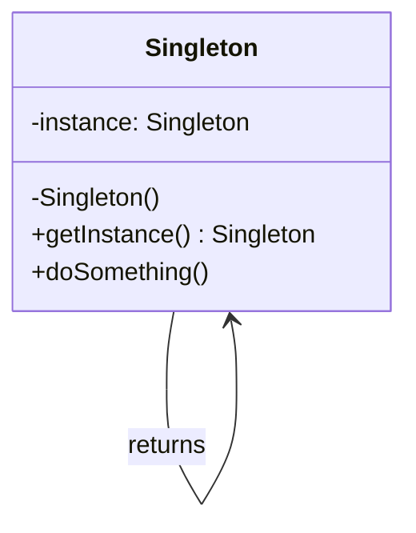
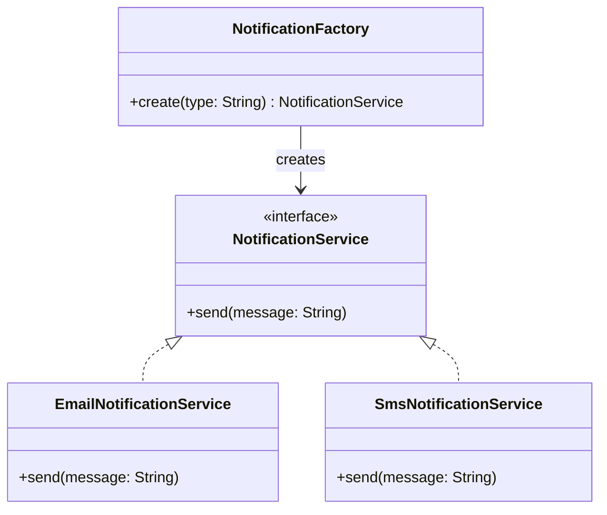
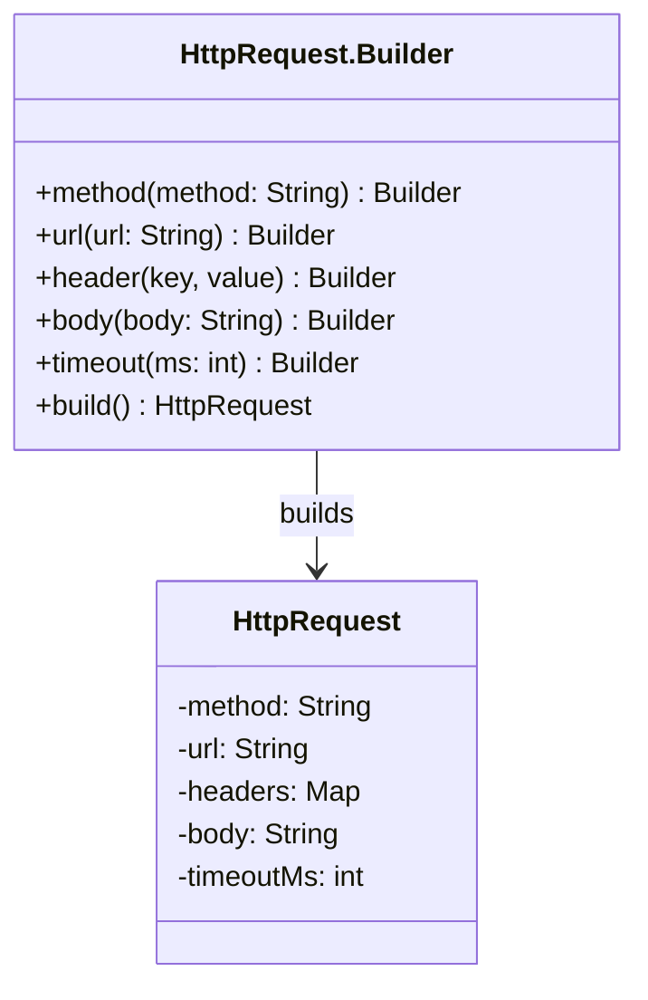
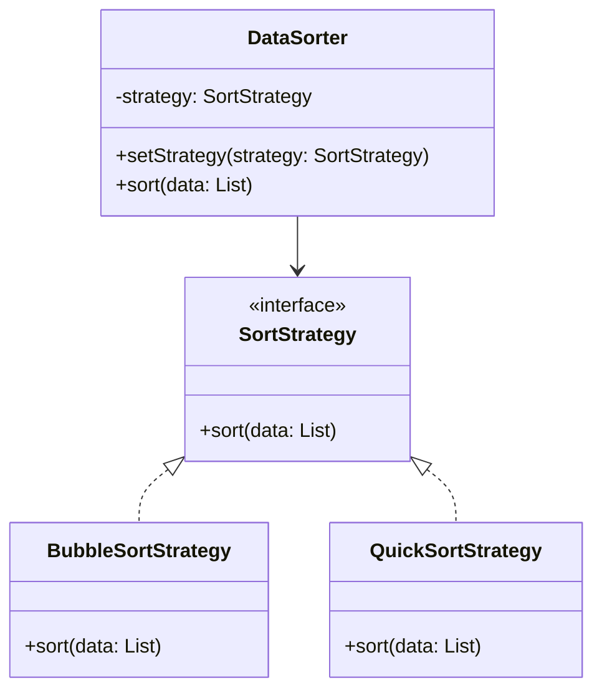
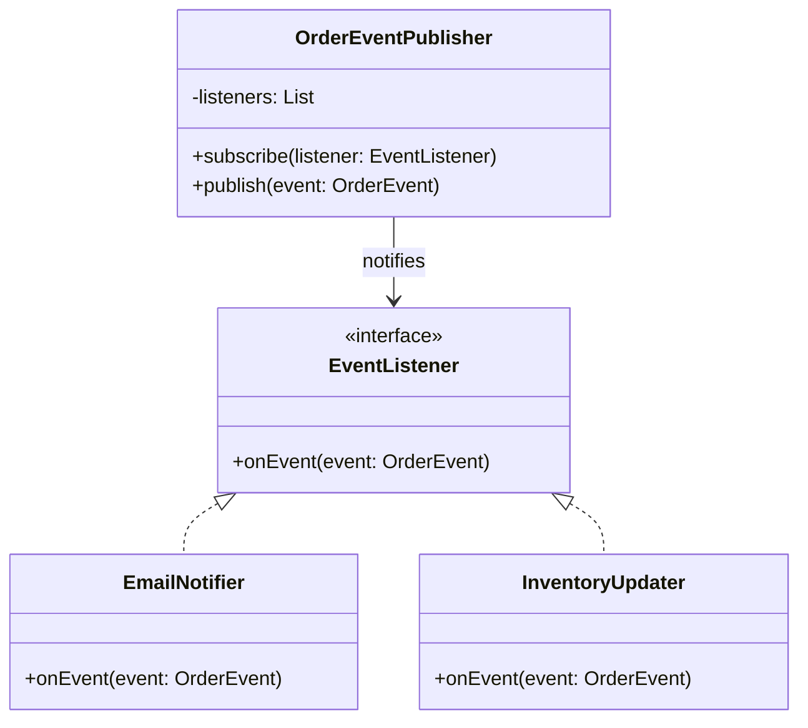
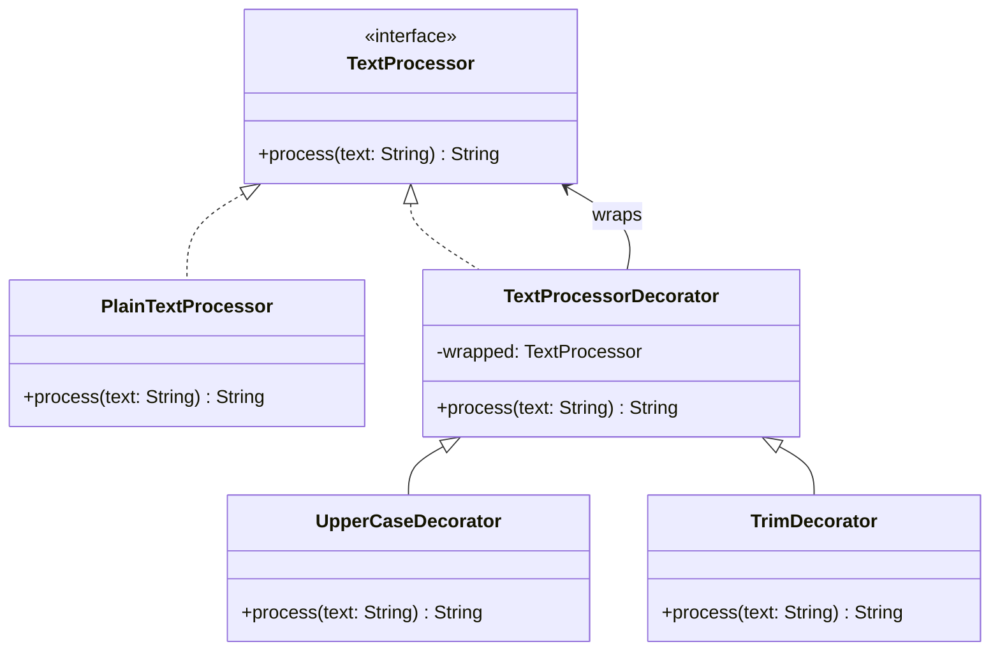
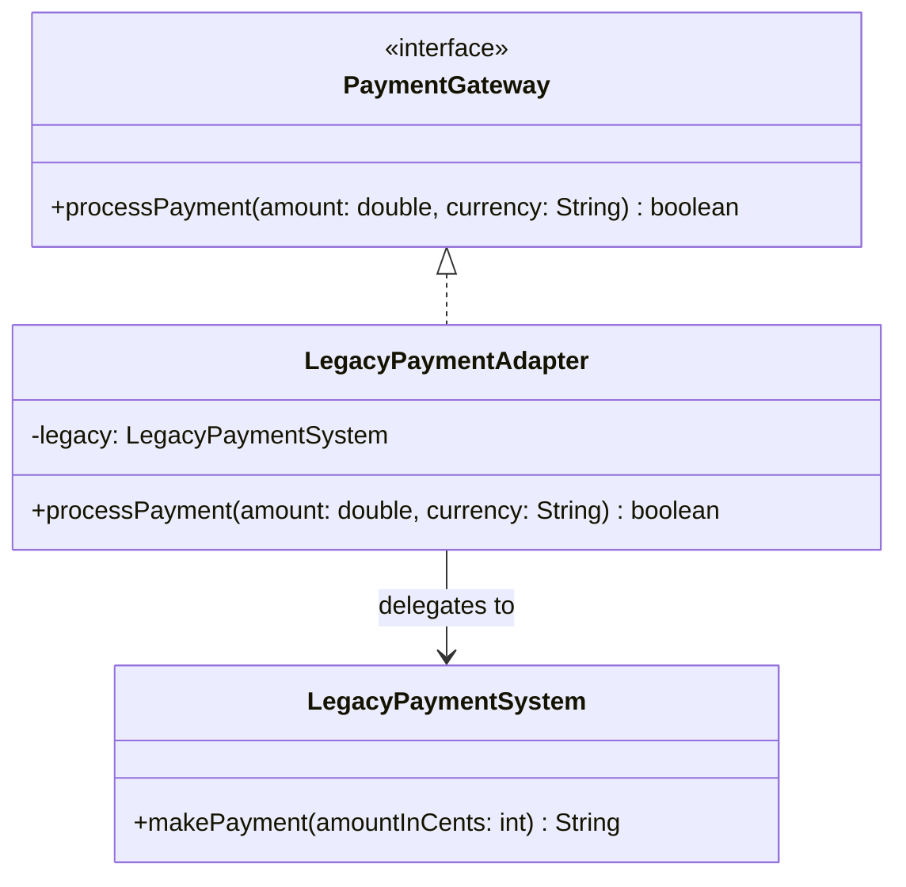

# Design Patterns

Design patterns are reusable solutions to problems that recur in software design. They are not code you copy — they are templates describing how to structure code to solve a category of problem. Knowing patterns gives you a shared vocabulary with other engineers ("let's use a Strategy here") and a toolkit for common design decisions.

---

## Creational Patterns

Creational patterns deal with how objects are created.

---

### 1. Singleton — One Instance

**Problem it solves:** Some objects should exist exactly once in the application — a configuration holder, a connection pool, a logging service. Creating multiple instances would cause bugs or waste resources.

**When to use it:** Shared resources, global configuration, logging.  
**When not to:** Do not use Singleton to avoid passing dependencies around — that creates hidden global state. In Spring Boot, `@Service` beans are singletons by default; prefer that over implementing Singleton yourself.

**UML:**


**Thread-safe implementation using enum (the best approach in Java):**

```java
public enum ApplicationConfig {
    INSTANCE;

    private final String databaseUrl;
    private final int maxConnections;

    ApplicationConfig() {
        // Load from environment or properties file
        this.databaseUrl    = System.getenv().getOrDefault("DB_URL", "jdbc:postgresql://localhost/app");
        this.maxConnections = Integer.parseInt(System.getenv().getOrDefault("DB_MAX_CONNECTIONS", "10"));
    }

    public String getDatabaseUrl()   { return databaseUrl; }
    public int    getMaxConnections() { return maxConnections; }
}

// Usage
String url = ApplicationConfig.INSTANCE.getDatabaseUrl();
```

**Thread-safe with double-checked locking (when enum is not suitable):**

```java
public class DatabasePool {

    private static volatile DatabasePool instance;

    private DatabasePool() {
        // initialize pool
    }

    public static DatabasePool getInstance() {
        if (instance == null) {
            synchronized (DatabasePool.class) {
                if (instance == null) {
                    instance = new DatabasePool();
                }
            }
        }
        return instance;
    }
}
```

---

### 2. Factory Method — Delegate Object Creation

**Problem it solves:** You need to create objects, but the exact type to create depends on runtime data. Hard-coding `new ConcreteClass()` throughout the codebase makes changing the type painful.

**When to use it:** When a method should return one of several possible classes, all sharing a common interface.

**UML:**


```java
public interface NotificationService {
    void send(String recipient, String message);
}

public class EmailNotificationService implements NotificationService {
    @Override
    public void send(String recipient, String message) {
        System.out.println("Email to " + recipient + ": " + message);
    }
}

public class SmsNotificationService implements NotificationService {
    @Override
    public void send(String recipient, String message) {
        System.out.println("SMS to " + recipient + ": " + message);
    }
}

public class PushNotificationService implements NotificationService {
    @Override
    public void send(String recipient, String message) {
        System.out.println("Push to " + recipient + ": " + message);
    }
}

public class NotificationFactory {

    public static NotificationService create(String type) {
        return switch (type.toUpperCase()) {
            case "EMAIL" -> new EmailNotificationService();
            case "SMS"   -> new SmsNotificationService();
            case "PUSH"  -> new PushNotificationService();
            default      -> throw new IllegalArgumentException("Unknown notification type: " + type);
        };
    }
}

// Usage
NotificationService service = NotificationFactory.create("EMAIL");
service.send("alice@example.com", "Your order has shipped");
```

---

### 3. Builder — Construct Complex Objects Step by Step

**Problem it solves:** Creating an object with many optional fields leads to telescoping constructors (many constructors with different parameter combinations) or constructors with too many arguments — violating Amalitech §4.3.

**When to use it:** When constructing objects with many fields, especially many optional ones.

**UML:**


```java
public final class HttpRequest {

    private final String method;
    private final String url;
    private final Map<String, String> headers;
    private final String body;
    private final int timeoutMs;

    private HttpRequest(Builder builder) {
        this.method    = builder.method;
        this.url       = builder.url;
        this.headers   = Map.copyOf(builder.headers);
        this.body      = builder.body;
        this.timeoutMs = builder.timeoutMs;
    }

    public String getMethod()               { return method; }
    public String getUrl()                  { return url; }
    public Map<String, String> getHeaders() { return headers; }
    public String getBody()                 { return body; }
    public int getTimeoutMs()               { return timeoutMs; }

    public static Builder builder(String method, String url) {
        return new Builder(method, url);
    }

    public static final class Builder {
        private final String method;
        private final String url;
        private final Map<String, String> headers = new LinkedHashMap<>();
        private String body;
        private int timeoutMs = 30_000; // default

        private Builder(String method, String url) {
            this.method = Objects.requireNonNull(method);
            this.url    = Objects.requireNonNull(url);
        }

        public Builder header(String name, String value) {
            headers.put(name, value);
            return this;
        }

        public Builder body(String body) {
            this.body = body;
            return this;
        }

        public Builder timeout(int timeoutMs) {
            this.timeoutMs = timeoutMs;
            return this;
        }

        public HttpRequest build() {
            return new HttpRequest(this);
        }
    }
}

// Usage
HttpRequest request = HttpRequest.builder("POST", "https://api.example.com/tasks")
        .header("Content-Type", "application/json")
        .header("Authorization", "Bearer token123")
        .body("{\"title\":\"New task\"}")
        .timeout(5_000)
        .build();
```

---

## Behavioral Patterns

Behavioral patterns deal with how objects communicate and divide responsibilities.

---

### 4. Strategy — Interchangeable Algorithms

**Problem it solves:** You have a class that needs to perform an operation, but the exact algorithm should be selectable at runtime (or easily changeable). Using `if-else` or `switch` to choose among algorithms is brittle — adding a new one means editing the class (OCP violation).

**When to use it:** Sorting strategies, payment methods, pricing rules, compression algorithms.

**UML:**


```java
@FunctionalInterface
public interface PaymentStrategy {
    void pay(double amount);
}

public class CreditCardPayment implements PaymentStrategy {
    private final String cardNumber;

    public CreditCardPayment(String cardNumber) {
        this.cardNumber = cardNumber;
    }

    @Override
    public void pay(double amount) {
        System.out.printf("Charged %.2f to credit card ending %s%n",
                amount, cardNumber.substring(cardNumber.length() - 4));
    }
}

public class PayPalPayment implements PaymentStrategy {
    private final String email;

    public PayPalPayment(String email) {
        this.email = email;
    }

    @Override
    public void pay(double amount) {
        System.out.printf("Paid %.2f via PayPal account %s%n", amount, email);
    }
}

public class ShoppingCart {
    private final List<Double> itemPrices = new ArrayList<>();

    public void addItem(double price) {
        itemPrices.add(price);
    }

    public void checkout(PaymentStrategy strategy) {
        double total = itemPrices.stream().mapToDouble(Double::doubleValue).sum();
        strategy.pay(total);
    }
}

// Usage
ShoppingCart cart = new ShoppingCart();
cart.addItem(29.99);
cart.addItem(49.99);
cart.checkout(new CreditCardPayment("4111111111111234"));
// Or: cart.checkout(new PayPalPayment("alice@example.com"));
// Or with a lambda: cart.checkout(amount -> System.out.println("Crypto: " + amount));
```

---

### 5. Observer — Event-Driven Communication

**Problem it solves:** One object (the subject) needs to notify multiple other objects (observers) when its state changes, without being tightly coupled to the observers. The subject should not need to know who the observers are.

**When to use it:** Event systems, UI frameworks, pub/sub, change notification.

**UML:**


```java
public record OrderEvent(String orderId, String status) {}

@FunctionalInterface
public interface OrderEventListener {
    void onOrderEvent(OrderEvent event);
}

public class OrderEventPublisher {
    private final List<OrderEventListener> listeners = new ArrayList<>();

    public void subscribe(OrderEventListener listener) {
        listeners.add(listener);
    }

    public void unsubscribe(OrderEventListener listener) {
        listeners.remove(listener);
    }

    public void publish(OrderEvent event) {
        listeners.forEach(listener -> listener.onOrderEvent(event));
    }
}

// Usage
OrderEventPublisher publisher = new OrderEventPublisher();

// Subscribe with lambdas (Strategy is @FunctionalInterface)
publisher.subscribe(event ->
        System.out.println("Email: Order " + event.orderId() + " is " + event.status()));
publisher.subscribe(event ->
        System.out.println("Inventory: processing order " + event.orderId()));

publisher.publish(new OrderEvent("ORD-001", "SHIPPED"));
// Both listeners are notified
```

---

### 6. Decorator — Add Behavior Without Subclassing

**Problem it solves:** You want to add responsibilities to an object dynamically without modifying the class and without creating an explosion of subclasses for every combination of behaviors.

**When to use it:** Logging, caching, authentication wrapping, compression, encryption.

**UML:**


```java
public interface TextProcessor {
    String process(String text);
}

public class PlainTextProcessor implements TextProcessor {
    @Override
    public String process(String text) {
        return text;
    }
}

// Base decorator — delegates to the wrapped processor
public abstract class TextProcessorDecorator implements TextProcessor {
    protected final TextProcessor wrapped;

    protected TextProcessorDecorator(TextProcessor wrapped) {
        this.wrapped = wrapped;
    }

    @Override
    public String process(String text) {
        return wrapped.process(text);
    }
}

public class UpperCaseDecorator extends TextProcessorDecorator {
    public UpperCaseDecorator(TextProcessor wrapped) {
        super(wrapped);
    }

    @Override
    public String process(String text) {
        return super.process(text).toUpperCase();
    }
}

public class TrimDecorator extends TextProcessorDecorator {
    public TrimDecorator(TextProcessor wrapped) {
        super(wrapped);
    }

    @Override
    public String process(String text) {
        return super.process(text).trim();
    }
}

// Usage — stack decorators at runtime
TextProcessor processor = new UpperCaseDecorator(
        new TrimDecorator(
                new PlainTextProcessor()));

System.out.println(processor.process("  hello world  "));
// → "HELLO WORLD"
```

---

### 7. Adapter — Bridge Incompatible Interfaces

**Problem it solves:** You have an existing class with a useful interface, but it does not match the interface your code expects. You cannot or do not want to modify either.

**When to use it:** Integrating third-party libraries, legacy code, or systems with different interfaces.

**UML:**


```java
// The interface your code expects
public interface PaymentGateway {
    boolean processPayment(double amount, String currency);
}

// A legacy payment system with a different interface (you cannot modify it)
public class LegacyPaymentSystem {
    public String makePayment(int amountInCents) {
        // Legacy API: returns "SUCCESS" or "FAILURE"
        System.out.println("Legacy payment: " + amountInCents + " cents");
        return "SUCCESS";
    }
}

// The adapter: makes LegacyPaymentSystem look like PaymentGateway
public class LegacyPaymentAdapter implements PaymentGateway {

    private final LegacyPaymentSystem legacySystem;

    public LegacyPaymentAdapter(LegacyPaymentSystem legacySystem) {
        this.legacySystem = legacySystem;
    }

    @Override
    public boolean processPayment(double amount, String currency) {
        int amountInCents = (int) (amount * 100);
        String result = legacySystem.makePayment(amountInCents);
        return "SUCCESS".equals(result);
    }
}

// Usage — the calling code only knows about PaymentGateway
public class OrderProcessor {
    private final PaymentGateway gateway;

    public OrderProcessor(PaymentGateway gateway) {
        this.gateway = gateway;
    }

    public void processOrder(double amount) {
        boolean success = gateway.processPayment(amount, "USD");
        System.out.println(success ? "Order processed" : "Payment failed");
    }
}

// Wire it up
PaymentGateway gateway = new LegacyPaymentAdapter(new LegacyPaymentSystem());
OrderProcessor processor = new OrderProcessor(gateway);
processor.processOrder(49.99);
```

---

## Pattern Summary

| Pattern | Category | Solves | Key idea |
|---------|----------|--------|---------|
| Singleton | Creational | Multiple instances of a shared resource | One instance, controlled access |
| Factory Method | Creational | Choosing which class to instantiate | Delegate `new` to a factory |
| Builder | Creational | Too many constructor parameters | Fluent, step-by-step construction |
| Strategy | Behavioral | Swappable algorithms | Interface + multiple implementations |
| Observer | Behavioral | Loose coupling for notifications | Subject notifies a list of listeners |
| Decorator | Structural | Adding behavior without subclassing | Wrap an object; delegate and extend |
| Adapter | Structural | Incompatible interfaces | Translate one interface to another |

---

## Patterns and SOLID

Design patterns naturally embody SOLID principles:

| Pattern | SOLID principles reinforced |
|---------|---------------------------|
| Singleton | SRP (centralizes one concern) |
| Factory Method | OCP (add products without changing factory), DIP |
| Builder | SRP (construction separated from use) |
| Strategy | OCP (add strategies without touching the context), DIP |
| Observer | OCP (add observers without changing the subject) |
| Decorator | OCP (extend behavior without modifying the class), SRP |
| Adapter | DIP (depends on abstractions, not concretions) |
