# Java Learning Roadmap

This document is your map through the entire Java Learning Notebook. It tells you what to study, in what order, how long to spend, and what you should be capable of at each milestone. Treat the time estimates as guides, not deadlines — depth matters more than speed.

---

## Visual Progression Overview

```
╔══════════════════════════════════════════════════════════════════╗
║                  JAVA LEARNING NOTEBOOK ROADMAP                  ║
╚══════════════════════════════════════════════════════════════════╝

  ┌─────────────────────────────────────────────────────────────┐
  │                  🟢 BEGINNER PATH (4–6 weeks)               │
  │                                                             │
  │  [00] Environment Setup                                     │
  │        ↓                                                    │
  │  [01] Java Fundamentals                                     │
  │        ↓                                                    │
  │  [02] OOP Basics                                            │
  │        ↓                                                    │
  │  [03] OOP Advanced Concepts                                 │
  └──────────────────────────┬──────────────────────────────────┘
                             ↓
  ┌─────────────────────────────────────────────────────────────┐
  │               🔵 INTERMEDIATE PATH (6–8 weeks)              │
  │                                                             │
  │  [04] Java Core APIs                                        │
  │        ↓                                                    │
  │  [05] Collections Framework                                 │
  │        ↓                                                    │
  │  [06] Exception Handling                                    │
  │        ↓                                                    │
  │  [07] File I/O and Serialization                            │
  └──────────────────────────┬──────────────────────────────────┘
                             ↓
  ┌─────────────────────────────────────────────────────────────┐
  │                🟠 ADVANCED PATH (8–10 weeks)                │
  │                                                             │
  │  [08] Functional Programming in Java                        │
  │        ↓                                                    │
  │  [09] Concurrency and Multithreading                        │
  │        ↓                                                    │
  │  [10] JVM Internals and Memory Model                        │
  │        ↓                                                    │
  │  [11] Design Patterns                                       │
  │        ↓                                                    │
  │  [12] Clean Code and SOLID Principles                       │
  └──────────────────────────┬──────────────────────────────────┘
                             ↓
  ┌─────────────────────────────────────────────────────────────┐
  │              🔴 PROFESSIONAL PATH (6–8 weeks)               │
  │                                                             │
  │  [13] Build Tools and Project Structure                     │
  │        ↓                                                    │
  │  [14] Testing in Java                                       │
  │        ↓                                                    │
  │  [15] Spring Boot and REST APIs                             │
  │        ↓                                                    │
  │  [16] Databases and Persistence                             │
  └─────────────────────────────────────────────────────────────┘
                             ↓
                    🏆 PRODUCTION-READY DEVELOPER
```

---

## Mermaid Flowchart

If your Markdown viewer supports Mermaid diagrams, the chart below renders as an interactive flowchart:

```mermaid
flowchart TD
    A([▶ Start]) --> P00[Phase 00\nEnvironment Setup]
    P00 --> P01[Phase 01\nJava Fundamentals]
    P01 --> P02[Phase 02\nOOP Basics]
    P02 --> P03[Phase 03\nOOP Advanced]

    P03 --> P04[Phase 04\nCore APIs]
    P04 --> P05[Phase 05\nCollections]
    P05 --> P06[Phase 06\nException Handling]
    P06 --> P07[Phase 07\nFile I/O]

    P07 --> P08[Phase 08\nFunctional Programming]
    P08 --> P09[Phase 09\nConcurrency]
    P09 --> P10[Phase 10\nJVM Internals]
    P10 --> P11[Phase 11\nDesign Patterns]
    P11 --> P12[Phase 12\nClean Code & SOLID]

    P12 --> P13[Phase 13\nBuild Tools]
    P13 --> P14[Phase 14\nTesting]
    P14 --> P15[Phase 15\nSpring Boot & REST]
    P15 --> P16[Phase 16\nDatabases & Persistence]

    P16 --> Z([🏆 Production-Ready])

    style A fill:#2ecc71,color:#fff
    style Z fill:#e74c3c,color:#fff
    style P00 fill:#a8d8a8
    style P01 fill:#a8d8a8
    style P02 fill:#a8d8a8
    style P03 fill:#a8d8a8
    style P04 fill:#a8c4e8
    style P05 fill:#a8c4e8
    style P06 fill:#a8c4e8
    style P07 fill:#a8c4e8
    style P08 fill:#f4c27f
    style P09 fill:#f4c27f
    style P10 fill:#f4c27f
    style P11 fill:#f4c27f
    style P12 fill:#f4c27f
    style P13 fill:#e8a8a8
    style P14 fill:#e8a8a8
    style P15 fill:#e8a8a8
    style P16 fill:#e8a8a8
```



---

## 🟢 Beginner Path — Phases 00–03

**Estimated duration:** 4–6 weeks  
**Goal:** Write, compile, and run working Java programs; understand the core OOP model

---

### Phase 00 — Environment Setup

**What you'll learn:**
- Installing JDK 21 (Temurin distribution recommended)
- Configuring `JAVA_HOME` and PATH environment variables
- Installing and navigating IntelliJ IDEA Community Edition
- Installing Apache Maven and verifying the installation
- Cloning this repository with Git
- Creating and running your first Java program ("Hello, World!")

**What you'll be able to do after:**
- Open IntelliJ IDEA, create a new Java/Maven project, write a class, and run it
- Use the terminal to compile and run `.java` files manually with `javac` and `java`
- Understand the difference between source code, bytecode, and execution

**Next phase:** 01 — Java Fundamentals

**Recommended time:** 2–3 days

---

### Phase 01 — Java Fundamentals

**What you'll learn:**
- Java program structure: packages, classes, the `main` method
- Primitive data types: `int`, `long`, `double`, `float`, `char`, `boolean`, `byte`, `short`
- Variable declaration, initialization, and naming conventions
- Type casting (implicit and explicit)
- Arithmetic, comparison, logical, and bitwise operators
- String basics: literals, concatenation, common methods
- Control flow: `if`, `else if`, `else`, `switch` expressions (Java 14+)
- Loops: `for`, `while`, `do-while`, enhanced `for`
- Arrays: declaration, initialization, iteration
- Reading input with `Scanner`

**What you'll be able to do after:**
- Write programs that accept user input, perform calculations, and output results
- Solve simple algorithmic problems using loops and conditions
- Understand why Java is statically typed and what that means in practice

**Next phase:** 02 — OOP Basics

**Recommended time:** 1–1.5 weeks

---

### Phase 02 — OOP Basics

**What you'll learn:**
- What a class is and how it differs from an object (instance)
- Defining fields (instance variables) and their default values
- Writing constructors: default, parameterized, and constructor chaining (`this()`)
- Writing instance methods and static methods
- The `this` keyword
- Access modifiers: `public`, `private`, `protected`, package-private
- Getters and setters (accessors and mutators)
- The `static` keyword for fields and methods
- Object references vs. primitive values
- `toString()`, `equals()`, and `hashCode()` overrides
- Introduction to the `Object` class

**What you'll be able to do after:**
- Model real-world entities as Java classes
- Create objects, call methods on them, and understand the object lifecycle
- Explain the difference between a class and an object to someone else

**Next phase:** 03 — OOP Advanced Concepts

**Recommended time:** 1–1.5 weeks

---

### Phase 03 — OOP Advanced Concepts

**What you'll learn:**
- Inheritance: `extends`, the `super` keyword, method overriding
- The Liskov Substitution Principle at an intuitive level
- Polymorphism: compile-time (overloading) and runtime (overriding)
- Encapsulation: why hiding implementation details matters
- Abstraction: abstract classes vs. interfaces
- Multiple interface implementation
- `final` classes, methods, and variables
- The `instanceof` operator and pattern matching (`instanceof` with binding variable, Java 16+)
- Enums: defining, using, and adding methods to enums
- Introduction to records (Java 16+)
- Inner classes and anonymous classes (brief introduction)

**What you'll be able to do after:**
- Design a class hierarchy for a real problem using inheritance and interfaces
- Explain polymorphism with concrete examples
- Choose between abstract class and interface and justify the choice

**Next phase:** 04 — Java Core APIs

**Recommended time:** 1.5–2 weeks

---

## 🔵 Intermediate Path — Phases 04–07

**Estimated duration:** 6–8 weeks  
**Goal:** Use the Java standard library with confidence; write programs that handle real data

---

### Phase 04 — Java Core APIs

**What you'll learn:**
- `String` in depth: immutability, the string pool, `String.format()`, `formatted()`, `strip()`, `repeat()`, `isBlank()`, `lines()`, text blocks (Java 15+)
- `StringBuilder` and `StringBuffer`: when and why
- `Math` class: common methods, random numbers
- Wrapper classes: `Integer`, `Double`, `Boolean`, etc., autoboxing and unboxing
- The `java.time` API (Java 8+): `LocalDate`, `LocalTime`, `LocalDateTime`, `ZonedDateTime`, `Duration`, `Period`, `DateTimeFormatter`
- `Arrays` utility class: `sort()`, `binarySearch()`, `copyOf()`, `fill()`
- `Objects` utility class: `requireNonNull()`, `isNull()`, `toString()`
- `System` class: `System.out`, `System.err`, `System.in`, `System.currentTimeMillis()`, `System.exit()`
- Introduction to `var` (local variable type inference, Java 10+)

**What you'll be able to do after:**
- Manipulate strings, numbers, and dates without reinventing the wheel
- Use `var` appropriately without losing readability
- Format output for user-facing programs

**Next phase:** 05 — Collections Framework

**Recommended time:** 1.5 weeks

---

### Phase 05 — Collections Framework

**What you'll learn:**
- The Collections hierarchy: `Iterable`, `Collection`, `List`, `Set`, `Queue`, `Deque`, `Map`
- `ArrayList` vs. `LinkedList`: when to use each
- `HashSet`, `LinkedHashSet`, `TreeSet`: uniqueness and ordering
- `HashMap`, `LinkedHashMap`, `TreeMap`: key-value storage
- `ArrayDeque` as a stack and queue
- `PriorityQueue`
- Generics: type parameters `<T>`, bounded wildcards `<? extends T>`, `<? super T>`
- The `Collections` utility class: `sort()`, `shuffle()`, `unmodifiableList()`, `synchronizedList()`
- Iterators: `Iterator`, `ListIterator`, the for-each loop under the hood
- `List.of()`, `Set.of()`, `Map.of()`: immutable collections (Java 9+)
- `Map.entry()`, `Map.getOrDefault()`, `Map.computeIfAbsent()`

**What you'll be able to do after:**
- Choose the right collection type for a given problem
- Explain the performance trade-offs between `ArrayList` and `LinkedList`, `HashMap` and `TreeMap`
- Write type-safe, generic code

**Next phase:** 06 — Exception Handling

**Recommended time:** 1.5 weeks

---

### Phase 06 — Exception Handling

**What you'll learn:**
- The exception hierarchy: `Throwable`, `Error`, `Exception`, `RuntimeException`
- Checked vs. unchecked exceptions
- `try`, `catch`, `finally`, `try-with-resources`
- Multi-catch blocks: `catch (IOException | SQLException e)`
- Throwing exceptions: `throw new SomeException("message")`
- The `throws` clause on method signatures
- Creating custom exception classes
- Best practices: when to catch, when to rethrow, never swallow exceptions silently
- Stack traces: how to read and interpret them
- Common exceptions: `NullPointerException`, `ArrayIndexOutOfBoundsException`, `ClassCastException`, `IllegalArgumentException`, `IllegalStateException`, `UnsupportedOperationException`

**What you'll be able to do after:**
- Write programs that handle failures gracefully without crashing
- Design a custom exception hierarchy for an application
- Read a stack trace and immediately identify the root cause

**Next phase:** 07 — File I/O and Serialization

**Recommended time:** 1 week

---

### Phase 07 — File I/O and Serialization

**What you'll learn:**
- `java.io` basics: `File`, `FileReader`, `FileWriter`, `BufferedReader`, `BufferedWriter`
- `java.nio.file` (NIO.2): `Path`, `Paths`, `Files`, `Files.readAllLines()`, `Files.writeString()`, `Files.walk()`
- Reading and writing binary data: `InputStream`, `OutputStream`, `FileInputStream`, `FileOutputStream`
- `try-with-resources` for safe resource management
- Serialization and deserialization: `Serializable`, `ObjectOutputStream`, `ObjectInputStream`
- Working with CSV files
- Handling character encoding: `StandardCharsets.UTF_8`
- File metadata: checking existence, size, last-modified, file type
- Directory operations: creating, listing, deleting directories

**What you'll be able to do after:**
- Read and write text and binary files reliably
- Process CSV data from files
- Explain the difference between `java.io` and `java.nio.file` and when to use each

**Next phase:** 08 — Functional Programming in Java

**Recommended time:** 1–1.5 weeks

---

## 🟠 Advanced Path — Phases 08–12

**Estimated duration:** 8–10 weeks  
**Goal:** Write modern, expressive, efficient, and maintainable Java code

---

### Phase 08 — Functional Programming in Java

**What you'll learn:**
- Functional interfaces: `Function`, `Consumer`, `Supplier`, `Predicate`, `BiFunction`, `UnaryOperator`, `BinaryOperator`
- Lambda expressions: syntax, capturing variables, effectively final
- Method references: static, instance, constructor (`ClassName::method`, `instance::method`, `ClassName::new`)
- The Stream API: `stream()`, `parallelStream()`
- Intermediate operations: `filter()`, `map()`, `flatMap()`, `distinct()`, `sorted()`, `peek()`, `limit()`, `skip()`
- Terminal operations: `collect()`, `forEach()`, `reduce()`, `count()`, `findFirst()`, `findAny()`, `anyMatch()`, `allMatch()`, `noneMatch()`, `min()`, `max()`
- Collectors: `Collectors.toList()`, `toSet()`, `toMap()`, `groupingBy()`, `joining()`, `counting()`
- `Optional<T>`: `of()`, `ofNullable()`, `empty()`, `isPresent()`, `ifPresent()`, `orElse()`, `orElseGet()`, `orElseThrow()`, `map()`, `flatMap()`, `filter()`
- Composing functions: `andThen()`, `compose()`, `Predicate.and()`, `Predicate.or()`, `Predicate.not()`
- The `@FunctionalInterface` annotation

**What you'll be able to do after:**
- Replace verbose loops with readable stream pipelines
- Write and pass lambda expressions as method arguments
- Use `Optional` to eliminate null-related bugs

**Next phase:** 09 — Concurrency and Multithreading

**Recommended time:** 2 weeks

---

### Phase 09 — Concurrency and Multithreading

**What you'll learn:**
- Processes vs. threads: concepts and differences
- Creating threads: extending `Thread`, implementing `Runnable`, using `Callable`
- Thread lifecycle: NEW, RUNNABLE, BLOCKED, WAITING, TIMED_WAITING, TERMINATED
- The `synchronized` keyword: synchronized methods and blocks
- Volatile variables and visibility
- `wait()`, `notify()`, `notifyAll()`
- The `java.util.concurrent` package:
  - `ExecutorService`, `Executors.newFixedThreadPool()`, `newCachedThreadPool()`, `newSingleThreadExecutor()`
  - `Future<T>` and `Callable<T>`
  - `CompletableFuture<T>`: `supplyAsync()`, `thenApply()`, `thenAccept()`, `thenCompose()`, `exceptionally()`, `allOf()`, `anyOf()`
  - `CountDownLatch`, `CyclicBarrier`, `Semaphore`
  - Atomic classes: `AtomicInteger`, `AtomicBoolean`, `AtomicReference`
  - Concurrent collections: `ConcurrentHashMap`, `CopyOnWriteArrayList`, `BlockingQueue`
- Thread safety: race conditions, deadlocks, livelocks, starvation
- Virtual threads (Java 21): introduction and use cases

**What you'll be able to do after:**
- Write thread-safe code and reason about concurrency issues
- Use `CompletableFuture` for non-blocking asynchronous operations
- Identify and fix deadlocks using thread dumps

**Next phase:** 10 — JVM Internals and Memory Model

**Recommended time:** 2 weeks

---

### Phase 10 — JVM Internals and Memory Model

**What you'll learn:**
- The Java compilation and execution pipeline: source → bytecode → JIT-compiled native code
- JVM memory areas: heap, stack, method area (metaspace), native method stack, PC register
- Heap generations: young generation (Eden + Survivor spaces), old generation (tenured)
- Garbage collection: mark, sweep, compact, copy algorithms
- GC algorithms: Serial, Parallel, G1 (default in Java 9+), ZGC, Shenandoah
- Understanding GC logs and tuning flags: `-Xmx`, `-Xms`, `-XX:+UseG1GC`
- ClassLoaders: bootstrap, extension (platform), application, custom
- The class loading process: loading, linking (verification, preparation, resolution), initialization
- The JIT compiler: interpreted mode, profiling, optimizations (inlining, dead code elimination, escape analysis)
- Memory leaks in Java: causes, detection with VisualVM or Java Mission Control
- `WeakReference`, `SoftReference`, `PhantomReference`

**What you'll be able to do after:**
- Explain what the JVM does when you run a Java program
- Tune JVM memory settings for a production application
- Use a profiler to identify memory leaks and hot methods

**Next phase:** 11 — Design Patterns

**Recommended time:** 2 weeks

---

### Phase 11 — Design Patterns

**What you'll learn:**

**Creational Patterns:**
- Singleton: thread-safe implementation using double-checked locking and enum
- Factory Method: decoupling creation logic from client code
- Abstract Factory: families of related objects
- Builder: constructing complex objects step by step
- Prototype: cloning objects

**Structural Patterns:**
- Adapter: bridging incompatible interfaces
- Decorator: adding behavior without subclassing
- Facade: simplifying complex subsystems
- Proxy: controlling access to an object
- Composite: tree structures of objects
- Bridge: separating abstraction from implementation

**Behavioral Patterns:**
- Strategy: interchangeable algorithms
- Observer: event-driven communication
- Command: encapsulating requests as objects
- Template Method: defining algorithm skeletons
- Chain of Responsibility: passing requests along a handler chain
- State: behavior that changes based on state
- Iterator: sequential access without exposing internals

**What you'll be able to do after:**
- Recognize common patterns in existing codebases
- Apply patterns to solve recurring design problems
- Discuss trade-offs of each pattern and when NOT to use them

**Next phase:** 12 — Clean Code and SOLID Principles

**Recommended time:** 2 weeks

---

### Phase 12 — Clean Code and SOLID Principles

**What you'll learn:**
- The SOLID principles with Java examples:
  - Single Responsibility Principle
  - Open/Closed Principle
  - Liskov Substitution Principle
  - Interface Segregation Principle
  - Dependency Inversion Principle
- DRY (Don't Repeat Yourself): extracting duplication into shared methods and classes
- KISS (Keep It Simple, Stupid): resisting over-engineering
- YAGNI (You Aren't Gonna Need It): building what is needed now, not what might be needed later
- Naming: meaningful names for variables, methods, classes, and packages
- Functions: small, single-purpose, side-effect-free where possible
- Comments: when they add value vs. when they mask unclear code
- Code smells: long methods, large classes, feature envy, primitive obsession, shotgun surgery, data clumps
- Refactoring techniques: extract method, rename, introduce parameter object, replace conditional with polymorphism
- Code formatting and static analysis tools: Checkstyle, SpotBugs, SonarLint

**What you'll be able to do after:**
- Review your own code critically and identify areas to improve
- Refactor a messy codebase into something readable and maintainable
- Apply Amalitech's coding standards naturally

**Next phase:** 13 — Build Tools and Project Structure

**Recommended time:** 2 weeks

---

## 🔴 Professional Path — Phases 13–16

**Estimated duration:** 6–8 weeks  
**Goal:** Build, test, and ship real Java applications following professional practices

---

### Phase 13 — Build Tools and Project Structure

**What you'll learn:**
- Maven: `pom.xml` structure, coordinates (groupId, artifactId, version), lifecycle (validate, compile, test, package, install, deploy)
- Maven plugins: `maven-compiler-plugin`, `maven-surefire-plugin`, `maven-jar-plugin`
- Dependency management: declaring dependencies, scopes (`compile`, `test`, `provided`, `runtime`), transitive dependencies
- Maven repositories: local (`~/.m2`), central, Nexus/Artifactory
- Multi-module Maven projects
- Gradle: `build.gradle` (Groovy DSL and Kotlin DSL), tasks, configurations, Gradle wrapper
- Comparison: Maven vs. Gradle — when to choose each
- Standard Maven project layout: `src/main/java`, `src/main/resources`, `src/test/java`, `src/test/resources`
- Creating executable JARs with dependencies (fat JARs)
- Introduction to build profiles

**What you'll be able to do after:**
- Create and manage a multi-module Maven project from scratch
- Add and manage dependencies without version conflicts
- Build and package a runnable JAR artifact

**Next phase:** 14 — Testing in Java

**Recommended time:** 1–1.5 weeks

---

### Phase 14 — Testing in Java

**What you'll learn:**
- Why testing matters: catching bugs early, enabling refactoring, documentation through tests
- JUnit 5: `@Test`, `@BeforeEach`, `@AfterEach`, `@BeforeAll`, `@AfterAll`, `@DisplayName`, `@Nested`, `@ParameterizedTest`, `@ValueSource`, `@CsvSource`, `@MethodSource`
- Assertions: `assertEquals`, `assertNotNull`, `assertTrue`, `assertThrows`, `assertAll`
- Mockito: `@Mock`, `@InjectMocks`, `@Spy`, `when().thenReturn()`, `verify()`, `ArgumentCaptor`, `doThrow()`
- Test-Driven Development (TDD): Red-Green-Refactor cycle
- Testing patterns: Arrange-Act-Assert (AAA), test isolation, test naming conventions
- Code coverage: what it measures and what it doesn't
- Integration testing: `@SpringBootTest`, `TestRestTemplate`, `MockMvc`
- Testing best practices: one assertion concept per test, avoid testing implementation details, test behavior not code

**What you'll be able to do after:**
- Write a comprehensive test suite for a Java class using JUnit 5 and Mockito
- Practice TDD by writing tests before implementation
- Explain the difference between unit tests, integration tests, and end-to-end tests

**Next phase:** 15 — Spring Boot and REST APIs

**Recommended time:** 1.5–2 weeks

---

### Phase 15 — Spring Boot and REST APIs

**What you'll learn:**
- Spring Framework core concepts: IoC container, dependency injection (constructor, field, setter), `ApplicationContext`
- Spring Boot: auto-configuration, starters, `@SpringBootApplication`, `SpringApplication.run()`
- Building REST APIs:
  - `@RestController`, `@RequestMapping`, `@GetMapping`, `@PostMapping`, `@PutMapping`, `@DeleteMapping`, `@PatchMapping`
  - `@PathVariable`, `@RequestParam`, `@RequestBody`, `@ResponseBody`, `@ResponseStatus`
  - `ResponseEntity<T>` for full HTTP response control
- HTTP fundamentals: methods, status codes, headers, request/response body
- JSON serialization with Jackson: `@JsonProperty`, `@JsonIgnore`, `@JsonFormat`
- Validation: `@Valid`, `@NotNull`, `@NotBlank`, `@Size`, `@Min`, `@Max`, `BindingResult`
- Global exception handling: `@ControllerAdvice`, `@ExceptionHandler`
- Spring Boot configuration: `application.properties`, `application.yml`, profiles
- Security basics: `spring-boot-starter-security`, basic authentication
- API documentation: Springdoc OpenAPI (Swagger UI)
- Actuator: health checks, metrics endpoints

**What you'll be able to do after:**
- Build a fully functional REST API with Spring Boot
- Handle validation and errors properly with meaningful HTTP responses
- Document your API with Swagger UI

**Next phase:** 16 — Databases and Persistence

**Recommended time:** 2 weeks

---

### Phase 16 — Databases and Persistence

**What you'll learn:**
- SQL fundamentals: SELECT, INSERT, UPDATE, DELETE, JOIN, WHERE, GROUP BY, ORDER BY, indexes
- JDBC: `DriverManager`, `Connection`, `PreparedStatement`, `ResultSet`, connection pooling with HikariCP
- JPA (Java Persistence API): entities, `@Entity`, `@Id`, `@GeneratedValue`, `@Column`, `@Table`
- Relationships: `@OneToOne`, `@OneToMany`, `@ManyToOne`, `@ManyToMany`, cascade types, fetch types (EAGER vs. LAZY)
- Spring Data JPA: `JpaRepository`, `CrudRepository`, custom query methods, `@Query` with JPQL and native SQL
- Hibernate: session, first-level cache, N+1 problem, `@Fetch`, `@BatchSize`
- Database migrations: Flyway and Liquibase
- Transactions: `@Transactional`, propagation levels, isolation levels, rollback rules
- Testing with an in-memory database: H2
- Introduction to NoSQL concepts

**What you'll be able to do after:**
- Build a complete Spring Boot application with a relational database backend
- Write complex JPA queries and understand their performance implications
- Manage database schema changes safely using migration tools

**Congratulations — you have reached the end of the roadmap. You are now a production-ready Java developer.**

---

## Weekly Study Plan Suggestions

### If you have 1 hour per day (7 hours/week)
- Expect the full roadmap to take approximately 10–12 months
- Focus on one concept per session; don't rush
- Prioritize understanding over completion speed
- Use weekends for small projects that apply the week's concepts

### If you have 2–3 hours per day (14–21 hours/week)
- Expect the full roadmap to take approximately 5–7 months
- Split sessions: first half for new material, second half for exercises
- After completing each phase, spend one day building a small project using everything you learned

### If you are studying full-time (5–8 hours per day)
- Expect the full roadmap to take approximately 3–4 months
- Take a 10-minute break every 50 minutes (Pomodoro technique)
- Dedicate Friday afternoons to reviewing the week's material
- Build a mini-project at the end of each path (Beginner, Intermediate, Advanced, Professional)

---

## Suggested Milestone Projects

After completing each path, build one of these projects to consolidate your skills:

| Path Completed | Project Suggestion |
|----------------|--------------------|
| Beginner (00–03) | A command-line bank account simulator: deposit, withdraw, check balance, using OOP |
| Intermediate (04–07) | A student grade tracker that reads/writes student data to CSV files and computes statistics |
| Advanced (08–12) | A multi-threaded file search tool that applies design patterns and clean code principles |
| Professional (13–16) | A RESTful Task Manager API with Spring Boot, JPA, PostgreSQL, full test suite, and Swagger docs |

---

## Tips for Staying Consistent

**1. Write code every day, even if only for 20 minutes.**  
Momentum matters more than marathon sessions. Twenty minutes of focused coding is worth more than a four-hour session once a week.

**2. Keep a learning journal.**  
After each session, write two or three sentences about what you learned and what confused you. This forces you to process the material and reveals patterns in what you struggle with.

**3. Teach what you learn.**  
Explain a concept out loud as if teaching it to someone. If you can't explain it clearly, you don't understand it yet. This is a fast way to find gaps.

**4. Revisit old phases.**  
After completing Phase 08 (Functional Programming), go back and rewrite some of your Phase 05 (Collections) exercises using streams. Applying new knowledge to old problems deepens both.

**5. Use the PROGRESS.md file.**  
Check off topics as you complete them. Seeing progress is motivating. When you feel stuck, look at how far you've come.

**6. Don't skip the exercises.**  
Reading code is not the same as writing it. The exercises are designed to surface misunderstandings that passive reading won't reveal.

**7. Accept confusion as part of the process.**  
Some concepts (concurrency, the JVM memory model, generics wildcards) will seem confusing the first time. Note them, move on, and return. They become clearer with context.

**8. Set a consistent schedule.**  
Studying at the same time each day removes the daily decision of whether to study. Treat your study sessions as fixed appointments.
